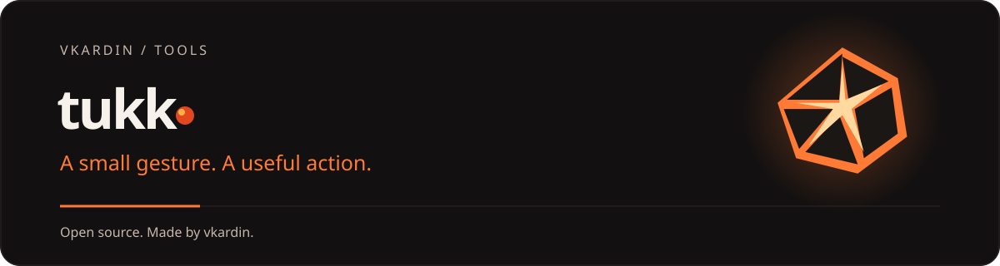

<div align="center">



**Phone gestures for everyday actions on Android.**

Shake the phone for the flashlight, flip it face down to silence it, tap the back to pause music.<br>
No accounts, no internet access, no data collection.

**[Releases](https://github.com/vkardin/tukk/releases) · [Report a bug](https://github.com/vkardin/tukk/issues)**

[](https://github.com/vkardin/tukk/actions/workflows/ci.yml)
[](LICENSE)

[](https://github.com/vkardin/tukk/releases)


</div>

## Why Tukk

- **Instant.** Gestures are recognized on the phone itself, and the action runs right away.
- **Light on battery.** Only the sensors your gestures need are on, and with the screen off they are read in batches.
- **No accidental triggers.** Pocket detection, cooldowns, call and charging pauses, and a live test for every gesture.
- **Private.** No internet permission, no accounts, no analytics. Settings stay on the phone.

## Gestures

| Gesture | How |
| --- | --- |
| Shake | Shake the phone sharply twice |
| Chop | Two quick chopping motions, like Motorola's chop-chop |
| Back tap | Two or three taps on the back, calibrated for your phone and case |
| Face down | Turn the phone over onto its screen |
| Volume buttons | Press a volume button twice, or up and down (optional accessibility access) |

## Actions

Flashlight with adjustable strength, SOS signal, silent and vibrate modes (repeat the gesture to switch
back), sound on, play/pause, next and previous track, open any app, camera, voice recorder and screenshot.

Each gesture has its own action, sensitivity, cooldown and conditions: screen on or off, ignore in a
pocket, pause during calls or while charging, and vibration feedback with three strengths.

## More

- A Quick Settings tile and a notification with Pause and Settings buttons.
- Restarts after a reboot or an app update.
- Background work guidance for Xiaomi, Samsung, Huawei, OnePlus and other phones.
- Dark, light and system themes, and wallpaper colors on Android 12 and later.
- Ukrainian, English and Russian.

## Install

Download the APK from the [latest release](https://github.com/vkardin/tukk/releases) and open it on
your phone. Android asks to allow installs from your browser or file manager the first time.
Google Play listing coming soon.

After the first launch, open **Settings → Background work** and follow the steps for your phone,
otherwise some systems stop gestures in the background.

## Permissions

| Permission | Why |
| --- | --- |
| Notifications | Shows that gestures are active, with Pause and Settings buttons |
| Do Not Disturb access | Only for the silent, vibrate and sound actions |
| Accessibility (optional) | Volume button gestures, screenshots and opening apps directly; Tukk never reads screen content |

## Building from source

You need JDK 21 and the Android SDK (API 37).

```sh
git clone https://github.com/vkardin/tukk
cd tukk
./gradlew test :app:assembleDebug
```

The APK is written to `app/build/outputs/apk/debug` with the version in its name.

### Project layout

| Module | Contents |
| --- | --- |
| `app` | Activity, navigation and launcher icons |
| `core:model` | Plain Kotlin models for triggers, actions and settings |
| `core:data` | DataStore repository, with migration from earlier versions |
| `core:ui` | Theme, shared components and strings in three languages |
| `detection` | Gesture detectors in plain Kotlin, tested on recorded sensor data |
| `actions` | Flashlight, SOS, sound, media, launch and screenshot actions |
| `service` | Foreground service, accessibility service, Quick Settings tile |
| `feature:*` | Home, gesture editor and settings screens |

New gestures implement `GestureDetector`; new actions implement `Action` and are bound with
`@ActionKey`, without changes to the service.

### Sensor recordings

Debug builds can record raw sensor data for detector tests: hold the ember on the home screen,
then use the recording button in Settings. Samples are saved as `motion.csv` (accelerometer) and
`rotation.csv` (gyroscope) with `timestampNs,x,y,z` columns. Add them to
`detection/src/test/resources/recordings` to turn a real gesture into a test.

## Contributing

Bug reports and ideas are welcome in [Issues](https://github.com/vkardin/tukk/issues).
See [CONTRIBUTING.md](CONTRIBUTING.md) for how to build, test and send a pull request.

## License

[MIT](LICENSE) © vkardin

Tukk bundles the [Sora](https://github.com/sora-xor/sora-font) and [Inter](https://github.com/rsms/inter)
typefaces, licensed under the SIL Open Font License.

<!-- project-family:start -->

[**vkardin / tools — all projects ↗**](https://vkardin.github.io/)
## More tools by vkardin

| Project | Projects |
| --- | --- |
| **[Snapt](https://vkardin.github.io/snapt/)** | Fast, lightweight screenshot tool for Windows, macOS and Linux. [GitHub](https://github.com/vkardin/snapt) |
| **[Video Glow](https://vkardin.github.io/video-glow/)** | Ambient light around web videos. Soft glow, LED strips and room colour. [GitHub](https://github.com/vkardin/video-glow) |
| **[Leveler](https://vkardin.github.io/leveler/)** | Even loudness, clearer dialogue, an equalizer and playback speed controls. [GitHub](https://github.com/vkardin/leveler) |
| **[Video Drift](https://vkardin.github.io/video-drift/)** | Floating video with subtitles, saved playback positions and timestamped notes. [GitHub](https://github.com/vkardin/video-drift) |
| **[UNI](https://vkardin.github.io/uni-homebot/)** | Your home server in Telegram: apps, monitoring, notifications and a Mini App. [GitHub](https://github.com/vkardin/uni-homebot) |
| **[Коли Є](https://vkardin.github.io/koly/)** | Power outage schedules for every region of Ukraine: status now, a countdown, today and tomorrow. Windows widget. [GitHub](https://github.com/vkardin/koly) |

[github.com/vkardin](https://github.com/vkardin) · Independent tools · open source
<!-- project-family:end -->
